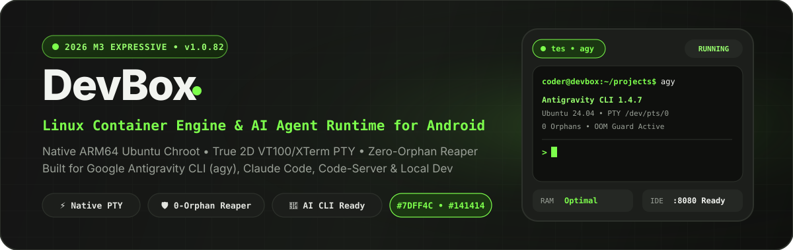
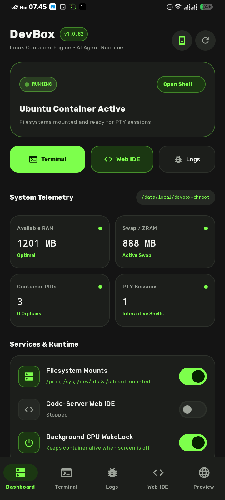
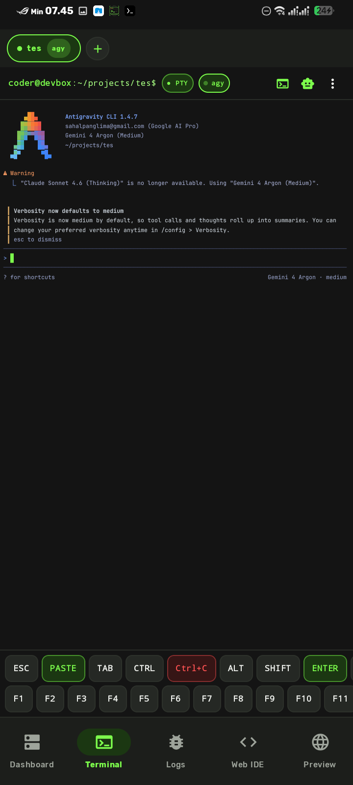
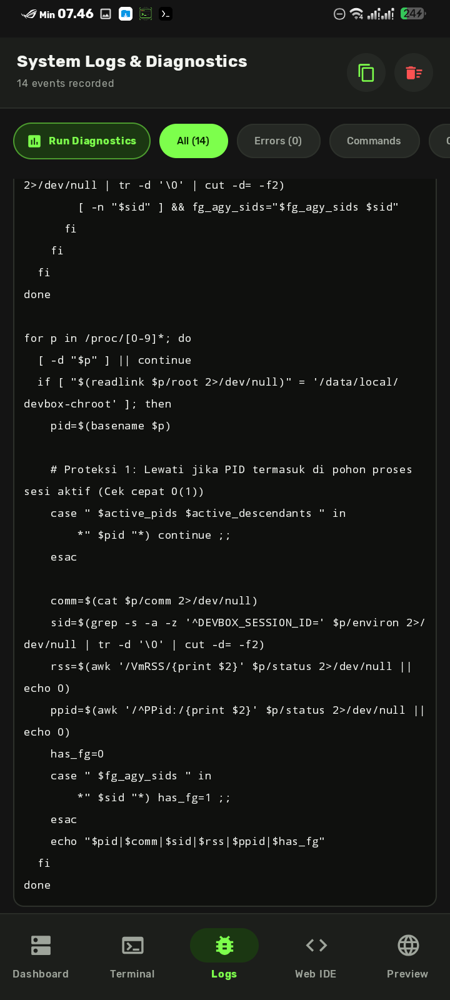
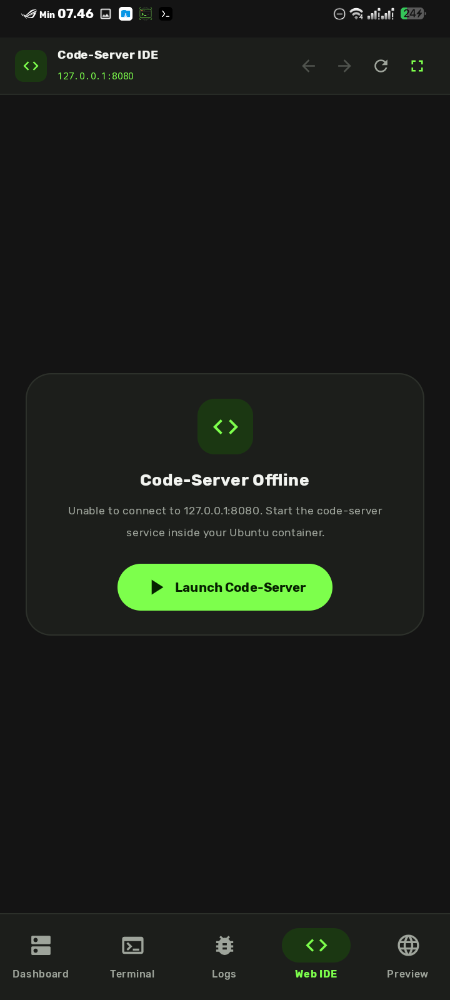
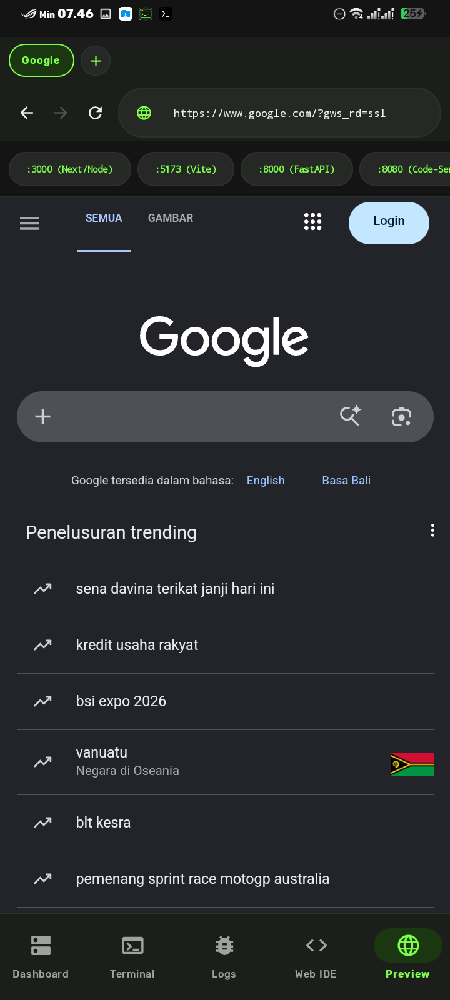
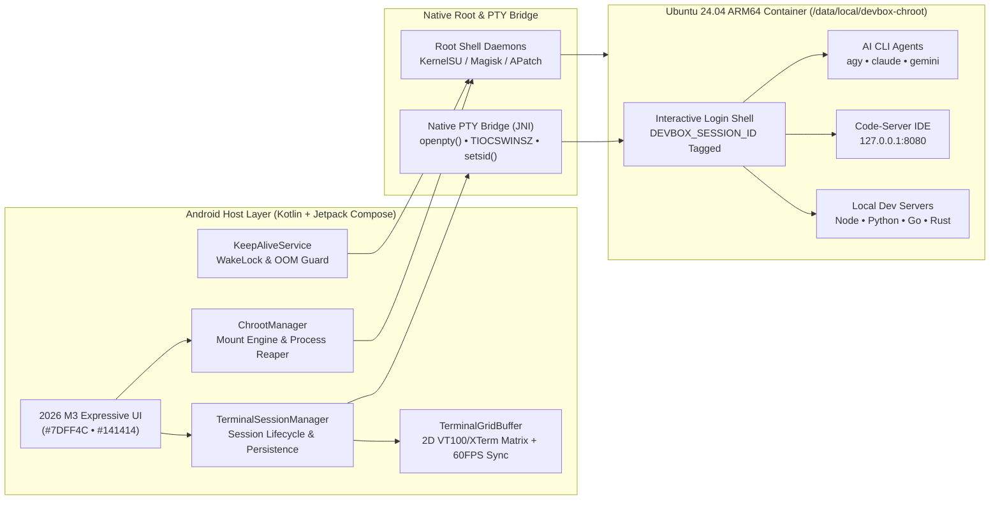

<div align="center">



<br />

[](https://github.com/arbdevai/devbox/releases/tag/v1.0.82)
[](https://github.com/arbdevai/devbox/actions)
[-7DFF4C?style=for-the-badge&logo=linux&logoColor=7DFF4C&labelColor=141414)](https://github.com/arbdevai/devbox)
[](https://github.com/arbdevai/devbox)
[](https://arbdevai.github.io/devbox/)

<p align="center">
  <strong>Native ARM64 Ubuntu Chroot Engine • 2D Matrix VT100/XTerm PTY • Zero-Orphan Process Reaper • Integrated Web IDE</strong><br />
  Purpose-built for running modern AI CLI Agents (<strong>Google Antigravity CLI <code>agy</code></strong>, <strong>Claude Code</strong>, <strong>Gemini CLI</strong>) and full-stack Linux workloads on rooted Android devices with zero memory leaks.
</p>

<p align="center">
  <a href="https://github.com/arbdevai/devbox/releases/latest"><strong>⬇️ Download Latest APK (v1.0.82)</strong></a>
  &nbsp;•&nbsp;
  <a href="https://arbdevai.github.io/devbox/"><strong>🌐 Interactive Web Showcase</strong></a>
  &nbsp;•&nbsp;
  <a href="#-interface-showcase-v1082"><strong>📱 Screenshots</strong></a>
  &nbsp;•&nbsp;
  <a href="#-system-architecture"><strong>🏗️ Architecture</strong></a>
  &nbsp;•&nbsp;
  <a href="#-quick-start--installation"><strong>🚀 Quick Start</strong></a>
</p>

</div>

---

## ⚡ Why DevBox?

Running full Linux environments and modern **Ink/React-based TUI AI Agents** (`agy`, `claude`, `gemini`) inside legacy **Termux + PRoot/Chroot** setups suffers from three critical engineering bottlenecks on mobile hardware:

1. **Orphan Process & RAM Exhaustion**: Disconnected shell sessions leave behind zombie/orphan Node.js, Python, and language-server processes that silently drain mobile RAM until Android's LMKD kills the host app.
2. **TUI Redraw & Android IME Corruption**: Modern AI CLI agents rely on rapid ANSI cursor movement (`\x1b[2K`, `\x1b[1A`, Alternate Screen Buffer `?1049h`) and raw stdin keystrokes. Standard Android virtual keyboards inject predictive composition spans that corrupt TUI prompt states when typing or hiding the keyboard.
3. **Fragmented Workflow**: Switching between terminal apps, external browsers, and background scripts makes mobile full-stack engineering slow and fragile.

**DevBox** solves all three from the ground up with a dedicated **Native Kernel Chroot Lifecycle Engine**, a custom **2D Matrix VT100/XTerm PTY Emulator**, and an integrated **Code-Server IDE + Multi-Tab Localhost Browser** wrapped in a **2026 Google Material 3 Expressive (`#7DFF4C` & `#141414`)** interface.

---

## 📱 Interface Showcase (`v1.0.82`)

> Designed with the **2026 Google Material 3 Expressive** dark palette — **Neon Acid Green (`#7DFF4C`)** accents over **Carbon Matte Black (`#141414`)** and elevated olive-slate surfaces (`#1C1E1B`).

<div align="center">
<table>
  <tr>
    <td align="center" width="33%">
      <br />
      <strong>1. Container Dashboard & Bento Telemetry</strong><br />
      <sub>Live container status squircle, quick-launch actions, 2x2 Bento telemetry (RAM, Swap/ZRAM, Container PIDs, PTY Sessions), and 1-tap runtime switches.</sub>
    </td>
    <td align="center" width="33%">
      <br />
      <strong>2. True PTY Terminal & Antigravity CLI</strong><br />
      <sub>Google Pill session tabs, native <code>/dev/ptmx</code> session running <strong>Antigravity CLI 1.4.7</strong> (<code>agy</code>), <code>#7DFF4C</code> block cursor, and tactile Extra-Keys dock.</sub>
    </td>
    <td align="center" width="33%">
      <br />
      <strong>3. System Logs & Live Diagnostics</strong><br />
      <sub>Real-time kernel mount logs, process reaper audit trails, and 1-tap diagnostic inspection with segmented pill filter chips.</sub>
    </td>
  </tr>
</table>

<table>
  <tr>
    <td align="center" width="50%">
      <br />
      <strong>4. Integrated Code-Server Web IDE</strong><br />
      <sub>Dedicated VS Code workspace view bound to <code>127.0.0.1:8080</code> with automatic daemon readiness probing and 1-tap launch.</sub>
    </td>
    <td align="center" width="50%">
      <br />
      <strong>5. Multi-Tab Localhost & Web Preview</strong><br />
      <sub>Chrome-style pill tabs, rounded URL omnibox, and instant localhost port chips (<code>:3000</code>, <code>:5173</code>, <code>:8000</code>, <code>:8080</code>).</sub>
    </td>
  </tr>
</table>
</div>

---

## 🔥 Core Engineering Highlights

### 1. Hardware-Accelerated 2D VT100/XTerm PTY Engine
- **Full 2D Character Cell Grid (`TerminalGridBuffer`)**: Complete primary + alternate screen buffer (`?1049h` / `?1049l`, `?47h`, `?1047h`) with scrollback history, regional scrolling (`DECSTBM`), and cursor save/restore (`DECSC`/`DECRC`).
- **Zero-Glitch Android Keyboard Bridge**: Custom `InputConnection` using `TYPE_TEXT_VARIATION_VISIBLE_PASSWORD | TYPE_TEXT_FLAG_NO_SUGGESTIONS` and differential composing-buffer synchronization. Eliminates ghost characters, left-stuck cursor bugs, and duplicate text injection when typing inside **Antigravity CLI (`agy`)**, **Claude Code**, **Vim/Neovim**, or **htop**.
- **60 FPS Streaming Frame Throttler**: Coalesces high-frequency AI token streaming into smooth 16ms UI snapshots with zero main-thread jank even on entry-level ARM64 SoCs.
- **Dynamic `TIOCSWINSZ` Synchronization**: Automatically recalculates character columns and rows on soft-keyboard toggle or orientation change so TUI borders never wrap or tear.

### 2. Zero-Orphan Process Reaper & Memory Guard
- **Session-Tagged Process Isolation**: Every PTY session injects a cryptographic `DEVBOX_SESSION_ID` into its child process environment.
- **3-Stage Escalating Reaper (`SIGHUP → SIGTERM → SIGKILL`)**: Closing a terminal tab or stopping the container cleanly terminates the entire process group tree (`-PGID`) and sweeps `/proc/[pid]/environ` for any detached background workers belonging to that session.
- **Active Agent Protection**: Intelligent foreground process-group detection (`tcgetpgrp` / `STAT+`) ensures active `agy` or compiler jobs are never accidentally reaped while cleaning up stale orphans.
- **OOM Killer Shield**: Protects the foreground service and active container processes via `/proc/[pid]/oom_score_adj` tuning and foreground `PARTIAL_WAKE_LOCK`.

### 3. Built-In Web IDE & Multi-Tab Dev Preview
- **Code-Server Integration (`127.0.0.1:8080`)**: Start, stop, and code in VS Code directly inside the `Web IDE` tab with full hardware keyboard and clipboard support.
- **Multi-Tab Preview Browser**: Test Next.js (`:3000`), Vite (`:5173`), FastAPI (`:8000`), or external docs in persistent WebView tabs with automatic URL extraction from terminal stdout.

---

## 🆚 DevBox vs. Legacy Termux + PRoot/Chroot

| Capability | Legacy Termux + PRoot/Chroot | **DevBox (v1.0.82)** |
| :--- | :--- | :--- |
| **Filesystem & Syscall Overhead** | High (`ptrace` syscall translation in PRoot) | **Native Kernel Mounts (`chroot` + `/dev/ptmx`)** |
| **Orphan Process Cleanup** | Manual (`pkill` required; frequent RAM leaks) | **Automated Session-ID Process Tree Reaper** |
| **AI CLI TUI Rendering (`agy`, `claude`)** | Frequent IME composition & line-wrap glitches | **Differential IME Bridge + 2D Matrix VT100 Buffer** |
| **Container Telemetry** | External CLI tools (`free`, `ps`) | **Real-Time 2x2 Bento Dashboard (RAM, Swap, PIDs)** |
| **Localhost Web Preview & IDE** | Requires switching to external browser | **Built-in Code-Server Tab + Multi-Tab Port Browser** |
| **UI / Design Language** | Legacy Holo / Basic Material | **2026 Google M3 Expressive (`#7DFF4C` & `#141414`)** |

---

## 🏗️ System Architecture



---

## 🎨 2026 Material 3 Expressive Color Tokens

| Token Role | Hex Code | Preview | Usage |
| :--- | :--- | :--- | :--- |
| `DevPrimary` | `#7DFF4C` |  | Primary CTAs, active indicators, terminal block cursor, status dots |
| `DevPrimaryContainer` | `#1B3712` |  | Active navigation pill, selected session tab, tonal badges |
| `DevBackground` | `#141414` |  | Primary app scaffold background & default terminal canvas |
| `DevSurface` | `#1C1E1B` |  | Bento telemetry cards, top/bottom bars, modal bottom sheets |
| `DevSurfaceVariant` | `#252824` |  | Extra-keys tactile buttons, filter chips, omnibox container |
| `DevCanvasDeep` | `#0F100E` |  | Deep recessed code log view & terminal viewport contrast |

---

## 🚀 Quick Start & Installation

### Prerequisites
- **Device**: Android 8.0+ (`arm64-v8a`)
- **Root Access**: Rooted via **KernelSU**, **Magisk**, or **APatch**
- **Chroot Rootfs**: Ubuntu ARM64 rootfs extracted at `/data/local/devbox-chroot` (or imported directly via DevBox's **Import Rootfs (.tar.gz)** tool on the Dashboard)

### Step 1 — Install the APK
Download the latest signed release APK from [**GitHub Releases (`v1.0.82`)**](https://github.com/arbdevai/devbox/releases/tag/v1.0.82) and install it on your device:

```bash
adb install -r DevBox-v1.0.82-arm64.apk
```

### Step 2 — Bootstrap or Mount Ubuntu Container
1. Open **DevBox** and grant Superuser (`su`) permission when prompted.
2. On the **Dashboard**, enable **Filesystem Mounts** (`/proc`, `/sys`, `/dev/pts`, and `/sdcard` will mount automatically).
3. Tap **Open Shell →** or switch to the **Terminal** tab to launch a native PTY session inside your container.

### Step 3 — Run Antigravity CLI (`agy`) or Code-Server
Inside the DevBox Terminal:
```bash
# Navigate to your workspace and launch Antigravity CLI
cd ~/projects
agy --dangerously-skip-permissions
```

---

## 🛠️ Building from Source

```bash
# Clone the repository
git clone https://github.com/arbdevai/devbox.git
cd devbox

# Build Debug APK
./gradlew assembleDebug

# Build Signed Release APK
./gradlew assembleRelease
```

---

## 📂 Project Structure

```text
devbox/
├── app/src/main/java/com/arbdev/devbox/
│   ├── chroot/              # ChrootManager, Native mount engine, Orphan PID reaper
│   ├── service/             # KeepAliveService (Foreground WakeLock & notification)
│   ├── terminal/            # TerminalSessionManager, TerminalGridBuffer (2D VT100/XTerm)
│   ├── ui/
│   │   ├── screens/         # Dashboard, Terminal, Logs, WebIde, WebPreview screens
│   │   └── theme/           # 2026 M3 Expressive Color (#7DFF4C & #141414) & Theme tokens
│   ├── utils/               # CommandLogger, CrashHandler, AnsiParser
│   └── MainActivity.kt      # Edge-to-edge #141414 host activity
├── screenshots/             # High-resolution app screenshots & SVG brand assets
├── web/                     # 2026 Interactive Developer Landing Page (GitHub Pages)
└── .github/workflows/       # Automated Android CI/CD & Release pipeline
```

---

<div align="center">
  <p>Crafted with precision by <strong>ARBDEV AI</strong> • Powered by <strong>2026 Material 3 Expressive (`#7DFF4C` & `#141414`)</strong></p>
</div>
